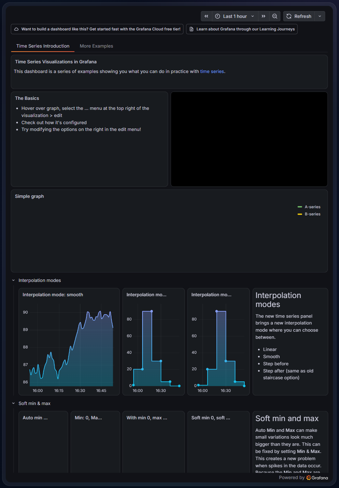

# MMM-GrafanaTrends

Shows a Grafana dashboard of home trends on a MagicMirror² page, inside a glass card that matches the other Glass modules. The dashboard switches between Grafana's light and dark themes to follow the mirror's day/night theme (`body.mm-day` / `body.mm-night`, set by MMM-GlassClock).

The module embeds the whole dashboard in one iframe rather than one iframe per panel. Each iframe runs its own copy of the Grafana app, so a single frame is much lighter on a Raspberry Pi.

A second instance can show the Indoor Plants dashboard on its own page and raise plant alerts on the mirror (popup, plus the Home Assistant email and iPhone push). See "Plants page and plant alerts" below. Plant alerts are off by default; with the default config the module behaves exactly as before.

## Screenshot

<p align="center">
  
</p>

*The glass card framing a dashboard in Grafana's dark theme (night mode). For this screenshot the
card shows Grafana's public "Time series graphs" demo instead of a home dashboard.*

## Dashboard

Two dashboards are used.

**Home trends (generated).** `grafana/build_dashboard.py` generates `grafana/mirror-trends.dashboard.json` from your entity IDs in `grafana/entities.json` (copy `grafana/entities.example.json` and edit it; both the entity map and the generated JSON are gitignored). It reads the Home Assistant InfluxDB integration (InfluxDB 1.x, InfluxQL) with its default schema: the measurement is the entity's unit of measurement (or the configured `default_measurement` when it has none), the `entity_id` tag holds the object id, and the numeric state is in field `value`. Each entry in `entities.json` gives the entity ID and its measurement.

| Panel | Range | Source |
|---|---|---|
| Offline devices / low batteries (counts and names) | latest | `sensor.devices_offline`, `sensor.devices_low_battery` (HA template sensors) |
| Water today, water per day, pressure and flow | today, 14 d, 48 h | Flo |
| EV energy and cost this month, EV kWh per day | month, 30 d | `sensor.ev_energy_today`, `sensor.ev_charging_cost_today` (HA utility meters) |
| Radon now and 30-day trend (action level 4 pCi/L) | 7 d, 30 d | EcoSense |
| Indoor vs outdoor temperature, indoor humidity | 48 h | Lennox / Nexia zones, Ambient Weather |
| HVAC run hours per day | 14 d | `sensor.hvac_*_runtime_today` (history_stats) |
| Fridge and freezer temperature | 48 h | Samsung fridge |
| Rain per day, Pi-hole blocked %, internet throughput | 30 d, 24 h | Ambient Weather, Pi-hole, UniFi |

The Home Assistant side (export filter, template sensors, utility meters) lives in the HA config repo as `packages/mirror_trends.yaml`.

Import: Grafana > Dashboards > New > Import > upload the JSON, and pick the InfluxDB data source when prompted. Generate it with `python3 grafana/build_dashboard.py` (again after any edit).

**Indoor Plants (hand-maintained).** The plants dashboard is not generated. It is a hand-maintained export in `grafana/indoor-plants.dashboard.json`: edit it in Grafana, export it, clean it up and commit it. `build_dashboard.py` does not touch it. Export steps, the clean-up rules and the re-import procedure are in [grafana/README-plants.md](grafana/README-plants.md). It has 10 panels on a 24 x 19 grid, which is what fixes the card height at 714 px.

## Install

No npm dependencies for the module itself (`grafana/build_dashboard.py` only needs Python 3's
standard library; plant alerts use Node built-ins only). Clone into your MagicMirror `modules/` folder:

```
cd ~/MagicMirror/modules
git clone https://github.com/hearter20176/MMM-GrafanaTrends.git
```

## Update

```bash
cd ~/MagicMirror/modules/MMM-GrafanaTrends
git pull
```

Then restart MagicMirror (for example `pm2 restart MagicMirror`).

## Grafana requirements

- Grafana must be reachable from the mirror, for example the Home Assistant Grafana add-on with its web port mapped (host port 3000). The add-on serves Grafana under its ingress path even on that port (`http://<ha-host>:3000/api/hassio_ingress/<id>/...`); requesting `/` redirects there, so use the full path in `url`.
- Embedding must be allowed: `GF_SECURITY_ALLOW_EMBEDDING=true`.
- The mirror must be able to view the dashboard without logging in. The narrowest option is to share only this dashboard externally (Share > Share externally) and use that link. Anonymous viewer access also works but exposes every dashboard in the org.

## Config

The `classes: "page3"` example below assumes MMM-pages is installed and `page3` is one of
its configured `modules` classes; add it there too, or this module just renders on every
page.

```js
{
  module: "MMM-GrafanaTrends",
  position: "middle_center",
  classes: "page3",
  config: {
    url: "http://<ha-host>:3000/public-dashboards/<access-token>",
    height: 1664
  }
},
```

### Grafana options

| Option | Default | Description |
|---|---|---|
| `url` | `""` | Dashboard URL (a shared/public link, or `/d/<uid>/<slug>?kiosk`) |
| `header` | `""` | Optional title above the dashboard |
| `width` | `"100%"` | iframe width (number = px) |
| `height` | `1664` | iframe height (number = px). Sized for the generated 44-row dashboard (44 rows x 30px + 43 x 8px margin ~= 1664px, plus kiosk padding). VERIFY against the actual render on the device; trim rows in `build_dashboard.py`, add `autofitpanels` to the URL, or adjust this value if the bottom row clips. The Indoor Plants dashboard needs `714` (see below). |
| `iframeTitle` | `"Grafana trends"` | The iframe's `title` attribute (accessibility). Set it per instance when running two. An empty value falls back to the default. |
| `followMirrorTheme` | `true` | Use Grafana's light theme in mirror day mode and dark at night, driven by MMM-GlassClock's `PAGE_THEME_CHANGED` notification (`body.mm-day` / `body.mm-night` set the initial theme before the first notification arrives) |
| `defaultTheme` | `"dark"` | Theme when not following the mirror, or before a day/night class is set |
| `reloadInterval` | `21600000` | Reload the iframe every 6 h so the page can't gradually use up memory (`0` = never) |
| `unloadWhenHidden` | `false` | Blank the iframe while its page is hidden; saves CPU but reloads Grafana every time the page is shown. Any reload requested while hidden (theme change, `reloadInterval`) is deferred until the page is shown again. |
| `loadTimeoutMs` | `20000` | How long to wait for the iframe to fire `load` at all before falling back to a failure. This does *not* detect Grafana being down, redirected to a login page, or refusing to embed - `load` fires for those too. See "Error handling" below; the node_helper probe is what actually detects them. |
| `retryDelayMs` | `60000` | First retry delay after a failed/timed-out load. Doubles on each consecutive failure, up to `maxRetryDelayMs`, instead of waiting for the full `reloadInterval`. Clamped to at least 5s in `start()` so a config of `0` can't turn an outage into a tight reload+probe loop. |
| `maxRetryDelayMs` | `600000` | Cap on the retry backoff delay. Also clamped to at least 5s. |

### Plant alert options

Only used by the one instance that has `plantAlertsEnabled: true`. The front end coerces them in `start()`; a non-numeric value falls back to the default, and the floors below apply. The node_helper re-applies the timing floors itself and does not trust the browser's values.

| Option | Type | Default | Description |
|---|---|---|---|
| `plantAlertsEnabled` | boolean | `false` | This instance polls Home Assistant (through the node_helper) and raises plant popups. Must be exactly `true`. Enable it on one instance only; the helper rejects a second owner. |
| `plantAlertEntity` | string | `"sensor.mirror_plant_alerts"` | The HA contract sensor to poll. Must match `sensor.[a-z0-9_]+`, otherwise the default is used. |
| `plantAlertPollMs` | number | `30000` | Poll period. Floor 10000. The next poll is scheduled this long after the previous one finishes. |
| `plantAlertTimeoutMs` | number | `10000` | Per-request timeout. Floor 2000, capped at `plantAlertPollMs - 1000`. |
| `plantAlertStaleMs` | number | `600000` | How long polls must keep failing before the "not monitored" line appears. Floor is the larger of 60000 and 2 x `plantAlertPollMs`. |
| `plantAlertPopupMs` | number | `120000` | How long each popup stays up. `0` = until the alerts clear. Otherwise floor 5000. |
| `plantAlertRepeatMs` | number | `1800000` | Re-show the popup this often while alerts stay active. `0` = never re-show. Otherwise floor 60000. |
| `plantAlertRecoveryNotice` | boolean | `true` | Show a short (10 s) notification when everything clears. Only `false` turns it off. |

There is no `haUrl` or `haTokenFile` option. The Home Assistant URL and token come from `ha-alerts.secret.json` (see "Secret file"). If either key is set in `config.js` anyway, the module logs one warning and ignores it; the value is not logged.

The DOM is built once and reused, so MagicMirror redraws never reload Grafana. It reloads on
a theme change, on `reloadInterval`, or after a failed load's retry backoff.

## Plants page and plant alerts

The Indoor Plants dashboard is shown by a second `MMM-GrafanaTrends` instance on its own MMM-pages page. That instance also owns the plant alerts.

### Why two pages

The home trends dashboard is 1664 px tall and the plants dashboard is 714 px (19 grid rows x 38 px - 8 px). Together that is 2378 px, which does not fit a 1920 px tall screen. So they cannot share a page: the plants card gets its own page (`page4` below). Because that card is only 714 px tall, you can put other modules on the same page; layout is left to your config.

### Example config

```js
{
  module: "alert"                       // core module; no position, no page class
},
{
  module: "MMM-pages",
  config: {
    modules: [
      ["page1"], ["page2"], ["page3"],
      ["page4"]                         // plants page
    ],
    fixed: ["MMM-page-indicator", "alert"]
  }
},
{
  module: "MMM-GrafanaTrends",          // home trends: unchanged, alerts off (default)
  position: "middle_center",
  classes: "page3",
  config: {
    url: "http://<ha-host>:3000/public-dashboards/<trends-token>",
    height: 1664
  }
},
{
  module: "MMM-GrafanaTrends",          // Indoor Plants: owns plant alerts
  position: "middle_center",
  classes: "page4",
  config: {
    url: "http://<ha-host>:3000/public-dashboards/<plants-token>",
    height: 714,                        // 19 grid rows * 38 - 8; VERIFY on the device
    iframeTitle: "Grafana plants",
    plantAlertsEnabled: true
    // optional: plantAlertPopupMs: 120000, plantAlertRepeatMs: 1800000
  }
},
```

Notes:

- The `alert` module (core, MagicMirror's default alert module) must be in `config.js`. It has no `position` and no page class. Without it the popups have nowhere to appear.
- Adding `"alert"` to MMM-pages `fixed` is belt and braces: it keeps MMM-pages from calling `hide()` on that module. It is harmless if the overlay is not affected by page changes anyway.
- Popups must work while the plants page is not showing, so the module does not stop the alert logic when its page is hidden (`suspend()`/`resume()` leave it alone). The popup is raised by the core alert module and appears on whichever page is up.
- If you enable alerts on more than one instance, only the first one to start owns the poller. The others are told "rejected", log one warning and do nothing. Nothing can double-poll or double-popup.
- With alerts enabled but no `url`, the module still polls and raises popups; the card just shows the usual "set the url" message.
- Create the plants share link in Grafana the same way as for the home dashboard (see "Grafana requirements").

### Zone symbols

Each plant zone has one symbol, so the same word on different panels ("Last watered", "Reservoir") can be told apart, and so a popup line matches the panel it refers to. Only these three characters are used, with no emoji and no variation selector.

| Zone | Symbol | Code point | Name |
|---|---|---|---|
| Family Room | ● | U+25CF | black circle |
| Dining Room | ▲ | U+25B2 | black up-pointing triangle |
| Kitchen | ■ | U+25A0 | black square |

`zones.js` is the single source of truth for zone ids, display names and symbols (back end only; the node_helper puts the symbol and the display name on every alert it forwards). Tests check that `grafana/indoor-plants.dashboard.json` and the HA package agree with it.

In Grafana the symbol is the first character of the title of every panel that belongs to a single zone, so the three "Last watered" and three "Reservoir" panels are distinguishable. For example, the Family Room panels are titled with the circle, a space, then "Family Room soil", "Last watered" and "Reservoir"; Dining Room uses the triangle and Kitchen the square. The same symbol prefixes the three series names (legend entries) of the multi-zone soil moisture trend and the three per-zone "watered" annotation names. Details are in [grafana/README-plants.md](grafana/README-plants.md).

In popups the symbol is the first character of each alert line. Two special symbols exist: `!` marks the "not monitored" line, and `?` marks an alert for a zone id the mirror does not know (the alert is still shown, with the raw zone id as its name).

### Secret file

The Home Assistant URL and long-lived token are read by the node_helper from a file that sits next to the module and is never committed:

```
~/MagicMirror/modules/MMM-GrafanaTrends/ha-alerts.secret.json
```

```
cd ~/MagicMirror/modules/MMM-GrafanaTrends
cp ha-alerts.secret.example.json ha-alerts.secret.json
chmod 600 ha-alerts.secret.json
nano ha-alerts.secret.json
```

```json
{
  "url": "http://homeassistant.local:8123",
  "token": "<long-lived access token>"
}
```

Rules the helper enforces:

- `url` must be `http:` or `https:`, with no query string or fragment. A trailing `/` is removed and a base path (reverse proxy) is allowed.
- `token` must be at least 20 characters with no whitespace. The placeholder in the example file is rejected on purpose, so copying the example without editing it fails loudly.
- The file must be 8 KiB or smaller and valid JSON.
- The file path is fixed. It cannot be changed from config or over the socket.
- `*.secret.json` and `*.secret` are gitignored.

Create a dedicated non-admin Home Assistant user for the mirror and create the long-lived token under that user (Profile > Security > Long-lived access tokens). Do not use your own admin token.

**Why config.js must not hold the token (or the URL).** MagicMirror serves `config.js` to the browser, and socket messages into the node_helper come from any browser that can reach the MagicMirror port. If the URL or a token path were supplied by the front end, anyone on the LAN could send a start message that points the helper at their own server, and the helper would hand over the real bearer token. Reading both from a fixed server-side file means nothing that arrives over the socket can redirect or expose the token. The token is never logged and never sent to the browser; log lines carry only the HA origin and a fixed status word.

Changing the file does not need a MagicMirror restart. While the helper is in `not_configured` or `auth_failed` it checks the file's modification time and size once a minute (a stat only, no HA traffic) and picks up a fixed file by itself. After you replace a token that HA rejected it makes exactly one attempt; a second rejection stops again.

If the file is missing or invalid, the plants card shows a notice ("Plant alerts disabled: create ha-alerts.secret.json (see README)") and a popup line says plant alerts are not monitored, with reason "not configured".

### Home Assistant side

The mirror only reads one entity, `sensor.mirror_plant_alerts`. Everything that decides what is an alert lives in Home Assistant and is documented in [docs/homeassistant/README.md](docs/homeassistant/README.md): install steps, the package [docs/homeassistant/mirror_plants.yaml](docs/homeassistant/mirror_plants.yaml), and the paste-in for your existing watering automations, [docs/homeassistant/plant-watering-stop-branch.md](docs/homeassistant/plant-watering-stop-branch.md). Follow those; they are not repeated here.

**Contract sensor.** `sensor.mirror_plant_alerts` is polled with `GET /api/states/sensor.mirror_plant_alerts`. Its state is the alert count as an integer string (`"0"` to `"20"`), and its attributes are:

| Attribute | Rule |
|---|---|
| `schema` | Number, must be `1`. |
| `alerts` | List, required even when empty. At most 20 entries are kept. |
| `alerts[].zone` | `family_room`, `dining_room` or `kitchen`. An unknown zone is kept and shown with `?`. |
| `alerts[].kind` | `connection_lost` or `reservoir_empty`. Any other kind is dropped. |
| `alerts[].device` | `soil_sensor` or `waterer` for `connection_lost`; `null` for `reservoir_empty`. |
| `alerts[].since` | ISO 8601 timestamp with offset. Invalid values just drop the "since" part of the line. |
| `alerts[].detail` | Optional plain text, cleaned and cut to 200 characters. |
| `alerts[].symbol` | Informational. The mirror always shows its own symbol; a different value counts as a problem with the poll. |

If the state is `unavailable`/`unknown`, the schema is wrong, the body is not valid JSON or the count does not match the list, the poll counts as failed (the alerts it still contains are shown, a real alert is never hidden). Alert text is escaped before it reaches the popup.

### What each alert does

| Alert | Trigger | Mirror popup | Email | iPhone push |
|---|---|---|---|---|
| Connection lost (per soil sensor and per waterer, 6 devices) | Device stale or unavailable past the HA debounce (15 min raise, 10 min clear by default) | Yes | Immediately, then every 6 h while unresolved, plus a "done" email | Time-sensitive push, re-sent every 6 h, cleared on recovery |
| Reservoir empty (per zone) | Your existing "no moisture increase" stop branch sets the zone's flag | Yes | Once, plus one resolved email | Same time-sensitive push |

The flag clears when moisture rises past the value at flag time by the configured delta, or when you press the zone's "Refilled" button in HA. The exact thresholds, cadence and notify service names are in the package, which is the source of truth for the email and push behavior. The "reached max pulses" branch of your automation is not a reservoir alert.

### Popup behavior

- One combined popup. All active alerts appear as one line each in a single "Plant alert" popup, not separate popups. Example lines: `Family Room - soil sensor offline since 14:05`, `Dining Room - reservoir may be empty since 09:40`. The time is `HH:MM` for today, otherwise `Mon D HH:MM`.
- Shown when a new alert appears (any alert not in the previous set).
- It stays for `plantAlertPopupMs` (default 2 min; `0` keeps it up until cleared) and is then hidden.
- Re-show: while any alert is still active it is shown again every `plantAlertRepeatMs` (default 30 min; `0` = never). A new alert while the popup is up replaces it with the full set and restarts both timers. When one of several alerts clears while the popup is visible, the popup is redrawn without restarting the timers; if the popup is hidden, nothing is shown until the next re-show.
- Hide on recovery: when the last alert clears the popup is hidden immediately and, unless `plantAlertRecoveryNotice` is `false`, a 10 s notification says "Plant alerts cleared" (or "Plant alert monitoring restored" if only the not-monitored line cleared).
- "Not monitored" notice: if the mirror cannot tell whether anything is wrong, it says so instead of staying silent. A line `! Plant alerts not monitored - <reason>` is added to the popup (and counts as a new alert, so it triggers a popup).
  - Raised after polls have failed for `plantAlertStaleMs` (default 10 min). The timer starts when the poller starts, so a mirror that boots before HA is up does not alarm straight away.
  - Raised immediately for `not configured` (no valid secret file) and for a rejected token (`token rejected (HTTP 401)` or `403`).
  - Other reasons: `Home Assistant unreachable`, `request timed out`, `HTTP <code>`, `entity not found`, `entity unavailable`, `malformed contract`, `unsupported schema`, `alert count mismatch`, `unknown zone`, `symbol mismatch`, `malformed alert entry`, `response too large`. They come from a fixed list, never from HA text.
  - While polls fail but the window has not passed, the last known alerts stay on screen.
  - Clears on the next good poll.
- A 401 or 403 is final: polling stops (so a bad token cannot trigger an HA `ip_ban`) and only resumes when the secret file changes.
- The plants card also shows a small notice bar for `not_configured` and for a rejected token.

### One-time setup order

1. Import `grafana/indoor-plants.dashboard.json` over the live Indoor Plants dashboard in Grafana (same uid, so it replaces it). The per-waterer symbols exist only in this file; until it is imported the Grafana panels show no symbols. See `grafana/README-plants.md`.
2. Install the Home Assistant package and paste the stop-branch snippet into each watering automation (`docs/homeassistant/README.md`). Home Assistant 2024.10 or newer is required (plural `triggers:` / `conditions:` / `actions:` syntax; `last_reported` needs 2024.3).
3. Create `ha-alerts.secret.json` on the Pi from `ha-alerts.secret.example.json`.
4. Add the second instance and MMM-pages page to `config.js` as above, then restart MagicMirror.
5. Run the end-to-end test in `docs/homeassistant/README.md`: raise a flag by hand and confirm the popup, email and phone push, then press Refilled and confirm they clear.

### Limitations

- iOS cannot make a notification un-dismissable. There is no sticky notification on iPhone. The package sends time-sensitive pushes (which can break through Focus modes) with a tag, re-sends them every 6 h and clears them on recovery, but a swiped-away push stays gone until the next cycle. The always-on reminders are the mirror popup and the 6-hourly email. Details in the HA README.
- Home Assistant tokens cannot be scoped to one entity. A non-admin user's token can still read every entity state over the REST API. The protection is the file permissions (`chmod 600`) and the fact that the token never leaves the Pi, not a narrow token.
- If Home Assistant is down, nothing alerts. The email and push alerts are run by HA, and the mirror popup depends on polling HA. The mirror can only tell you that HA is not being monitored (the "not monitored" line after 10 min), and only when someone is looking at the mirror.
- Phone pushes are re-sent at HA start and every 6 h on the clock (00:00, 06:00, 12:00, 18:00) for each active alert, so an HA restart or automation reload does not stop them. Email repeats every 360 minutes from the raise.
- The popup depends on how MagicMirror's core `alert` module behaves, and that could not be checked off the Pi. The module assumes the 2.2x-2.3x behavior: `type: "alert"` popups are keyed by the sending module and stay until `HIDE_ALERT` when no `timer` is passed, `title`/`message` are rendered as HTML, and the overlay is attached to the page body so MMM-pages does not hide it. To avoid the uncertain parts the module never passes `timer` on an alert and sends `HIDE_ALERT` before every re-show. Run this once on the Pi:

  ```
  grep -n "safe\|timer\|sender.name" ~/MagicMirror/modules/default/alert/alert.js ~/MagicMirror/modules/default/alert/templates/*.njk
  ```

  Expect `sender.name` used as the key in `alert.js` and `| safe` on the message in the templates. If the templates escape the message (no `| safe`), the popup shows literal tags; the fix is confined to `buildShowAlertPayload` in `plant-alert-popup.js` (emit plain text lines joined with `" | "`). If `HIDE_ALERT` is not honored for `type: "alert"`, that is a problem to report, not to work around elsewhere.
- Polling uses REST every 30 s with one request in flight, so a state change shows on the mirror within about 30 s, not instantly.

### Checks to run on the mirror

1. `ls -l ha-alerts.secret.json` shows `-rw-------`, and `git status` does not list it.
2. After a restart, the MagicMirror log shows `plant alerts: <origin> ok (HTTP 200)`. A `not_configured` or `auth_failed` line means the secret file or token needs attention.
3. The grep above: confirm `| safe` on the message and `sender.name` keying.
4. Force an alert (for example turn a reservoir flag on in HA) and confirm one popup appears with the right symbol, repeats at your `plantAlertRepeatMs`, and hides with a "cleared" notification when you clear it.
5. Rename the secret file and confirm the notice bar and the "not monitored - not configured" line appear, then restore it and confirm recovery without restarting MagicMirror (allow up to a minute).
6. Confirm the plants card at `height: 714` shows all 19 rows without clipping or a scrollbar, and the symbols in the panel titles render as plain glyphs (not color emoji) in the mirror's browser.
7. Confirm popups appear while the other pages are showing.

## Error handling

Detecting "Grafana is unreachable/blocked" can't rely on the iframe alone: in Chromium, the
`load` event fires for a blocked frame (`X-Frame-Options`/CSP `frame-ancestors`), a redirect to
Grafana's login page, and a normal successful load alike - there's no way to tell them apart
from the front end. `error` only fires for a small subset of network-level failures and never
for an embedding refusal.

The module's `node_helper.js` therefore probes the dashboard URL server-side on every `_load()`
(`GRAFANA_TRENDS_PROBE` / `GRAFANA_TRENDS_PROBE_RESULT`): it makes a plain HTTP(S) request and
treats it as a failure on a network error, a non-2xx/timeout status, a 3xx redirect to a login
page, an `X-Frame-Options: DENY|SAMEORIGIN` header, or a CSP `frame-ancestors` that excludes the
mirror's own origin. The probe result is authoritative for showing/hiding the error overlay.

The 20s `loadTimeoutMs` iframe-side timer is a secondary fallback for a fully hung connection
(nothing responds at all, so even the probe's own request would eventually time out). Both the
iframe's `load` event and either probe outcome (ok or not) clear it; since the probe normally
answers within its 10s socket timeout - well before the 20s mark - this timer only ends up
mattering when the node_helper itself isn't running or can't be reached.

On any failure (probe or iframe timeout), the module shows an overlay message ("Grafana is
unavailable - retrying in Ns") and retries with exponential backoff (`retryDelayMs`, doubling,
capped at `maxRetryDelayMs`) instead of waiting for `reloadInterval`. The probe never logs the
dashboard URL or its public-dashboard share token - only the request's origin is logged, and
only on failure.

Each probe request carries a `requestId`; a reply for a request that's no longer the latest one
(e.g. a slow reply arriving after a newer theme-change reload already started) is ignored, so it
can't flip the overlay/backoff state for the wrong load. `config.url` is resolved against the
page's own origin before it's sent to the helper (the same way it's resolved for the iframe), so
a relative or reverse-proxy URL (e.g. `/grafana/d/x?kiosk`) works instead of the helper reporting
"invalid dashboard url" for a setup the iframe itself accepts fine.

The plant alert poller is separate from this probe and has its own failure handling, described under "Popup behavior".

## Theme param

`_buildUrl()` appends `?theme=light|dark` to the dashboard URL. This is honoured by normal
kiosk-mode dashboard URLs. VERIFY whether the public/shared-dashboard link's `theme` param is
honoured on the Grafana version running on the Home Assistant add-on - support for it on public
dashboards varies by version.

## License

MIT, see [LICENSE](LICENSE).
